<!-- Banner -->
<p align="center">
  
</p>

<p align="center">
  
</p>

<p align="center">
  <a href="https://g4vo-dev.github.io"></a>
  <a href="https://www.linkedin.com/in/gustavo-barbosa-5ba811200"></a>
  <a href="mailto:gustavo17barbosas@gmail.com"></a>
</p>

---

## 🧪 → 💻 Quem sou eu

Oi! Eu sou o **Gustavo**, mas pode me chamar de **Zet**. Sou **técnico em Química pelo SENAI**, estudo **Análise e Desenvolvimento de Sistemas** na Uninter e estou procurando **estágio em desenvolvimento back-end**, com disponibilidade imediata.

Passei por laboratório e controle de qualidade na indústria. Na última vaga, como auxiliar de laboratório, criei uma automação em Excel (VBA) integrada ao LIMS que cortou uma rotina de 30 para 15 minutos, cerca de 18 horas economizadas por mês. No laboratório aprendi que **um resultado só vale se der para repetir**, e é assim que eu programo: testes automatizados, CI verde e cada passo registrado.

```js
const zet = {
  base: "Técnico em Química · SENAI (2024)",
  hoje: ["Estudante de ADS · Uninter (EAD)", "procurando estágio em back-end"],
  stack: ["Node.js", "JavaScript", "Baileys", "SQLite", "Termux"],
  construindo: "bots de WhatsApp que tiram trabalho repetitivo das pessoas",
  aberto_a: ["estágio em desenvolvimento", "freelas de bots e automação"],
  mora_em: "Grande São Paulo 🇧🇷",
  gato: { nome: "Tom", cor: "preto", cargo: "QA de teclado 🐈‍⬛" },
};
```

## 🔬 Do laboratório para o código

| No laboratório 🧪 | No código 💻 |
|---|---|
| Procedimento operacional padrão (POP) | README, scripts `npm run` e passo a passo documentado |
| Controle de qualidade em cada lote | Testes automatizados e lint a cada commit |
| Calibrar o equipamento antes de medir | Validar a entrada antes de processar |
| Laudo e rastreabilidade da amostra | Logs, histórico do Git e versões com tag |
| Contraprova guardada | Backup e modo demonstração para testar sem risco |

## 🤖 O que eu construo

<table>
  <tr>
    <td width="50%" valign="top">
      <h3>📲 <a href="https://github.com/G4vo-dev/assistente-whatsapp">assistente-whatsapp</a></h3>
      <p>Assistente pessoal no WhatsApp: controle de <b>finanças</b> com cartões e parcelas, <b>IA</b> com troca automática entre provedores (Groq, Gemini, Mistral, OpenRouter), transcrição de áudio, leitura de comprovantes e figurinhas.</p>
      <p><code>Node.js</code> <code>Baileys</code> <code>SQLite</code> <code>43 testes</code> <code>CI ✅</code></p>
    </td>
    <td width="50%" valign="top">
      <h3>💈 Assistente para comércios <sub>🔒 privado</sub></h3>
      <p>Um bot só que vira atendente de <b>barbearia, estúdio de tatuagem ou salão</b>, escolhendo o perfil na ativação. O cliente agenda, pede orçamento e recebe lembrete; o dono gerencia tudo pelo próprio chat.</p>
      <p><code>API oficial do WhatsApp</code> <code>Webhook</code> <code>Agenda</code> <code>CI ✅</code></p>
    </td>
  </tr>
  <tr>
    <td width="50%" valign="top">
      <h3>🍄 <a href="https://github.com/G4vo-dev/projeto-mario">projeto-mario</a></h3>
      <p>Landing page responsiva com vídeo de fundo e trailer em modal.</p>
      <p><code>HTML</code> <code>CSS</code> <code>JavaScript</code></p>
    </td>
    <td width="50%" valign="top">
      <h3>🌐 <a href="https://github.com/G4vo-dev/g4vo-dev.github.io">g4vo-dev.github.io</a></h3>
      <p>Meu site pessoal com portfólio e contato.</p>
      <p><code>GitHub Pages</code> <code>HTML</code> <code>CSS</code></p>
    </td>
  </tr>
</table>

> 💼 **Tem um negócio e quer atender no WhatsApp sem ficar preso ao celular?** [Me chama](mailto:gustavo17barbosas@gmail.com) que eu monto o bot para você.

## 🛠️ Ferramentas

<p align="center">
  
</p>
<p align="center">
  
  
  
  
</p>

## 🗺️ Minha jornada

```text
  2024 ●  Técnico em Química · SENAI
       │
mar/25 ●  Auxiliar de laboratório · indústria de cosméticos
       │
nov/25 ●  Aprendiz de qualidade · indústria agro
       │
mai/26 ●  Auxiliar de laboratório · indústria de lubrificantes
       │  Automação em VBA + LIMS: rotina de 30 para 15 minutos
       │
set/26 ●  Primeiro bot de WhatsApp, rodando no Termux direto do celular
       │
nov/26 ●  Começo de Análise e Desenvolvimento de Sistemas · Uninter
       │  Bots publicados com testes, lint e CI
       │  Saída do laboratório para focar em desenvolvimento
       │
  next ○  SQLite no lugar dos JSON · painel web para os comércios · primeiro estágio em dev
```

## 📊 Estatísticas

<p align="center">

  
</p>

<p align="center">
  
</p>

## 🎮 Fora do terminal

<details>
<summary><b>Clique para abrir o inventário</b> 🎒</summary>
<br />

| | |
|---|---|
| 🕹️ **Consoles retrô** | Importo do Japão (Buyee, JPFans), restauro e modifico: Nintendo 3DS XL, PS3 e Xbox 360 |
| 🃏 **Pokémon** | Coleciono Pokémon TCG e jogo ROM hacks: Radical Red, Unbound, Quetzal e Añil |
| 🏀 **Esporte** | Basquete |
| 🐈‍⬛ **Pet** | Tom, um gato preto que acha que o teclado é cama |
| 🎧 **Playlist** | Rock, samba, Sotam, Calcinha Preta e BTS, tudo na mesma fila |
| 📺 **Maratonas** | The Office, Soul Eater, Naruto, The Boondocks e South Park |
| 👕 **Estilo** | Oversized / Y2K |

</details>

<p align="center">
  <i>"Primeiro a hipótese, depois o experimento, por fim o commit."</i>
</p>

<p align="center">
  
</p>
